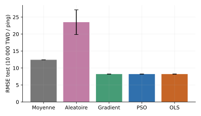
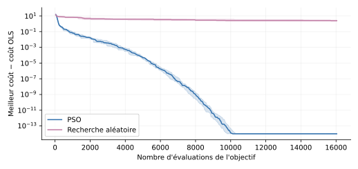
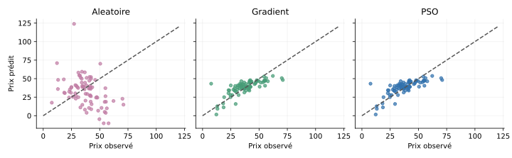

# Régression linéaire et optimisation par PSO

Mini-projet d’optimisation numérique comparant **PSO**, **descente de gradient**, **recherche aléatoire** et **moindres carrés (OLS)** pour prédire les prix immobiliers.

**Réalisé par :** Abderrahman Boubligha et Mohamed Reda Lakouas.

## Données et méthode

La base UCI Real Estate Valuation contient **414 observations et 6 variables**. Le partage principal utilise 331 observations pour l’apprentissage et 83 pour le test (graine 42). La standardisation est calculée uniquement sur l’apprentissage.

Le PSO cherche les 7 coefficients de la régression avec 40 particules et 400 itérations. PSO et recherche aléatoire sont évalués sur 20 initialisations, avec le même budget de 16 040 évaluations.

## Résultats

Moyennes sur le partage principal. RMSE et MAE sont exprimées en **10 000 TWD par ping** ; les temps correspondent à l’implémentation et à l’environnement utilisés.

| Méthode | RMSE ↓ | MAE ↓ | R² ↑ | Temps moyen (ms) |
|---|---:|---:|---:|---:|
| Moyenne d’apprentissage | 12,4216 | 9,5698 | ≈ 0 | < 0,001 |
| Recherche aléatoire | 23,5020 | 18,5251 | −2,6612 | 124,537 |
| Descente de gradient | 8,2099 | 6,1620 | 0,5632 | 6,314 |
| PSO | 8,2099 | 6,1620 | 0,5632 | 283,532 |
| Moindres carrés (OLS) | 8,2099 | 6,1620 | 0,5632 | 0,046 |

Le PSO retrouve une solution proche d’OLS et du gradient, mais demande davantage de calcul. Il dépasse la recherche aléatoire dans ce protocole. Sur les cinq partages supplémentaires, sa RMSE varie de 7,33 à 11,25 : la stabilité de l’optimisation ne garantit pas la précision prédictive.

### Comparaison des erreurs



### Convergence



### Prédictions



## Exécution

```bash
pip install -r requirements.txt
python src/experience.py
```

Pour reproduire l’étude complète :

```bash
python src/etude_complete.py
python src/tables_rapport.py
```

Pour ouvrir l’application :

```bash
streamlit run application/app.py
```

L’application prédit un prix par unité de surface à partir de données historiques de Taiwan (2012–2013). Elle ne fournit pas une estimation des prix actuels.

## Rapport et fichiers

- [Rapport PDF](rapport/rapport.pdf) et [source LaTeX](rapport/rapport.tex).
- `src/` : algorithmes et expériences.
- `application/` : interface Streamlit.
- `data/` : données originales et CSV.
- `results/` : scores, coefficients et résultats détaillés.

## Source des données

I-Cheng Yeh (2018), **Real Estate Valuation**, UCI Machine Learning Repository. [DOI : 10.24432/C5J30W](https://doi.org/10.24432/C5J30W). Licence [CC BY 4.0](https://creativecommons.org/licenses/by/4.0/).
